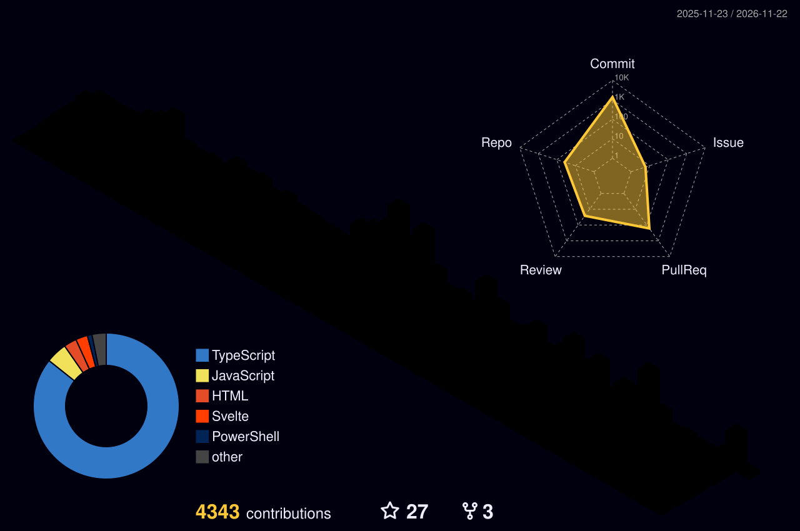

  

  
  
  
  

## 🛠️ What I build with

  

## 🕒 Recently active

<!-- RECENT:START -->
| Repository | What it is | Language | Last push |
|---|---|---|---|
| [**havilah-site**](https://github.com/oduwoleeyinojuoluwa44/havilah-site) | — | TypeScript | 17 days ago |
| [**happy-birthday-oyindamola**](https://github.com/oduwoleeyinojuoluwa44/happy-birthday-oyindamola) | — | HTML | 7 Oct 2026 |
| [**tempo-planner**](https://github.com/oduwoleeyinojuoluwa44/tempo-planner) | A Structured-style visual day planner — neobrutalist, local-first, React + Vite + Tailwind | JavaScript | 29 Sept 2026 |
| [**fast-man**](https://github.com/oduwoleeyinojuoluwa44/fast-man) | — | Python | 23 Jul 2026 |
| [**fast-man-frontend**](https://github.com/oduwoleeyinojuoluwa44/fast-man-frontend) | — | TypeScript | 23 Jul 2026 |

Refreshed automatically on 22 Nov 2026.
<!-- RECENT:END -->

## 📊 Contributions in 3D

  <picture>
    <source media="(prefers-color-scheme: dark)" srcset="profile-3d-contrib/profile-night-rainbow.svg" />
    <source media="(prefers-color-scheme: light)" srcset="profile-3d-contrib/profile-green-animate.svg" />
    
  </picture>

## 🔥 Streak

  

## 🐍 Eating my contribution graph

  <picture>
    <source media="(prefers-color-scheme: dark)" srcset="https://raw.githubusercontent.com/oduwoleeyinojuoluwa44/oduwoleeyinojuoluwa44/output/github-snake-dark.svg" />
    <source media="(prefers-color-scheme: light)" srcset="https://raw.githubusercontent.com/oduwoleeyinojuoluwa44/oduwoleeyinojuoluwa44/output/github-snake.svg" />
    
  </picture>

